# All city maps

Each combined figure shows White alone, Black alone, Hispanic of any race, and Asian alone. Values are `n*v_i` with node mean 1. All cities use the same logarithmic color scale; outside-range values are flagged.

[Open the interactive HTML gallery](https://battlecode2020.github.io/APMA4903-segregation-transit/outputs/multicity/walk_access_revision/maps/index.html) · [Download all 12 combined figures](docs/outputs/multicity/walk_access_revision/maps/combined_map_overviews.zip)

## New York City

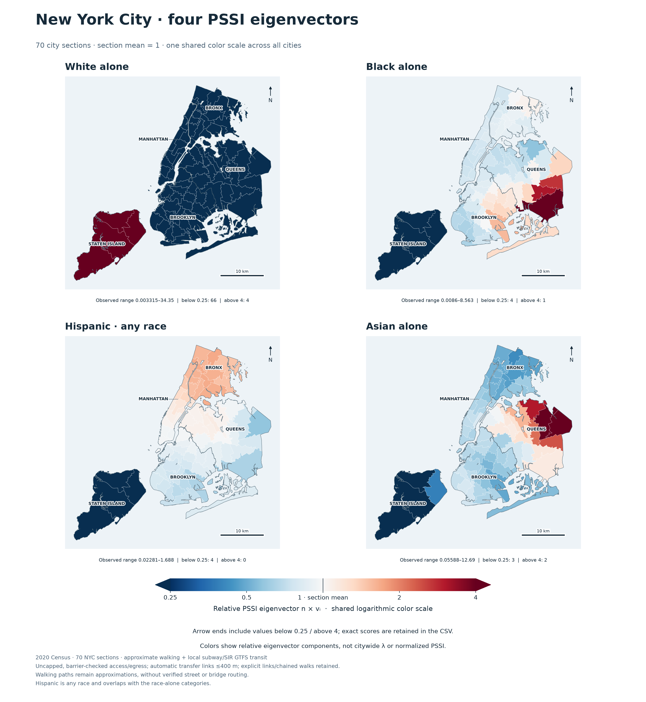

[White alone](docs/outputs/multicity/walk_access_revision/maps/new_york_city/white_alone_pssi_eigenvector.png) · [Black alone](docs/outputs/multicity/walk_access_revision/maps/new_york_city/black_alone_pssi_eigenvector.png) · [Hispanic · any race](docs/outputs/multicity/walk_access_revision/maps/new_york_city/hispanic_latino_any_race_pssi_eigenvector.png) · [Asian alone](docs/outputs/multicity/walk_access_revision/maps/new_york_city/asian_alone_pssi_eigenvector.png) · [Exact values](docs/outputs/multicity/walk_access_revision/maps/new_york_city/section_eigenvectors.csv)

## Philadelphia

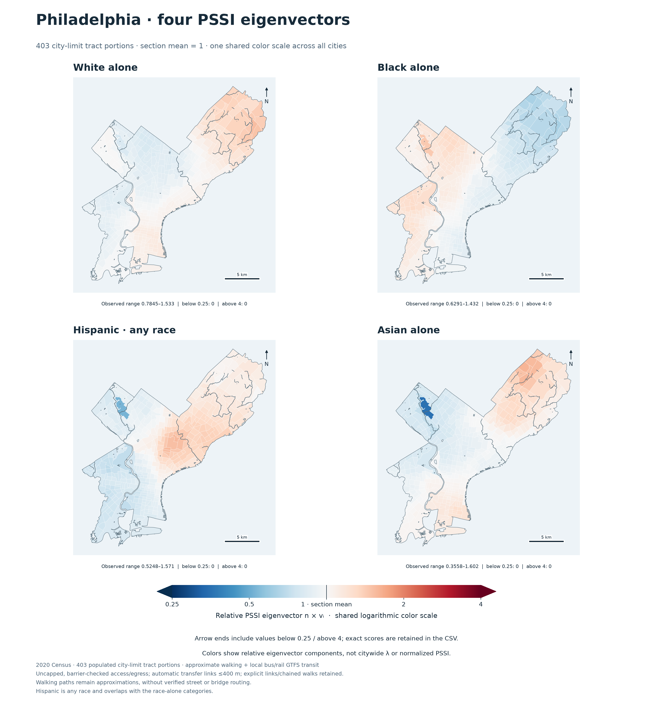

[White alone](docs/outputs/multicity/walk_access_revision/maps/philadelphia/white_alone_pssi_eigenvector.png) · [Black alone](docs/outputs/multicity/walk_access_revision/maps/philadelphia/black_alone_pssi_eigenvector.png) · [Hispanic · any race](docs/outputs/multicity/walk_access_revision/maps/philadelphia/hispanic_latino_any_race_pssi_eigenvector.png) · [Asian alone](docs/outputs/multicity/walk_access_revision/maps/philadelphia/asian_alone_pssi_eigenvector.png) · [Exact values](docs/outputs/multicity/walk_access_revision/maps/philadelphia/section_eigenvectors.csv)

## Miami

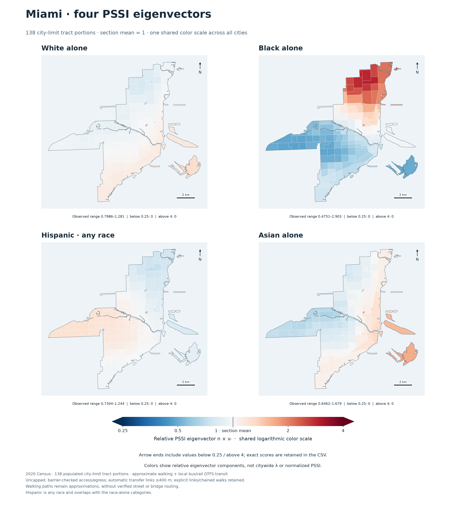

[White alone](docs/outputs/multicity/walk_access_revision/maps/miami/white_alone_pssi_eigenvector.png) · [Black alone](docs/outputs/multicity/walk_access_revision/maps/miami/black_alone_pssi_eigenvector.png) · [Hispanic · any race](docs/outputs/multicity/walk_access_revision/maps/miami/hispanic_latino_any_race_pssi_eigenvector.png) · [Asian alone](docs/outputs/multicity/walk_access_revision/maps/miami/asian_alone_pssi_eigenvector.png) · [Exact values](docs/outputs/multicity/walk_access_revision/maps/miami/section_eigenvectors.csv)

## Los Angeles

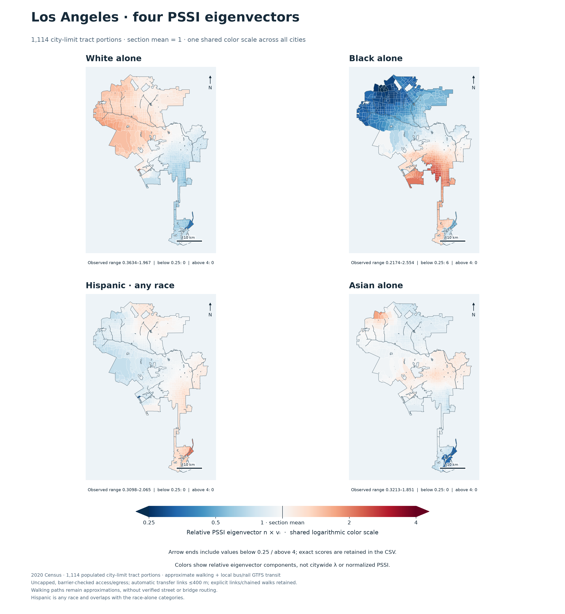

[White alone](docs/outputs/multicity/walk_access_revision/maps/los_angeles/white_alone_pssi_eigenvector.png) · [Black alone](docs/outputs/multicity/walk_access_revision/maps/los_angeles/black_alone_pssi_eigenvector.png) · [Hispanic · any race](docs/outputs/multicity/walk_access_revision/maps/los_angeles/hispanic_latino_any_race_pssi_eigenvector.png) · [Asian alone](docs/outputs/multicity/walk_access_revision/maps/los_angeles/asian_alone_pssi_eigenvector.png) · [Exact values](docs/outputs/multicity/walk_access_revision/maps/los_angeles/section_eigenvectors.csv)

## Salt Lake City

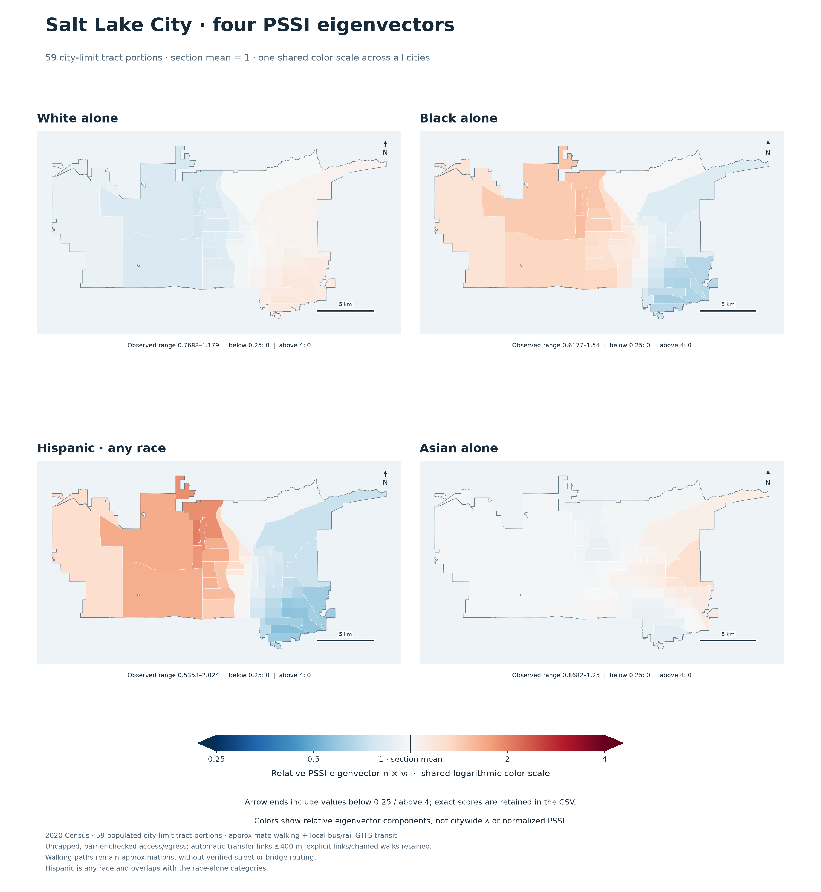

[White alone](docs/outputs/multicity/walk_access_revision/maps/salt_lake_city/white_alone_pssi_eigenvector.png) · [Black alone](docs/outputs/multicity/walk_access_revision/maps/salt_lake_city/black_alone_pssi_eigenvector.png) · [Hispanic · any race](docs/outputs/multicity/walk_access_revision/maps/salt_lake_city/hispanic_latino_any_race_pssi_eigenvector.png) · [Asian alone](docs/outputs/multicity/walk_access_revision/maps/salt_lake_city/asian_alone_pssi_eigenvector.png) · [Exact values](docs/outputs/multicity/walk_access_revision/maps/salt_lake_city/section_eigenvectors.csv)

## San Francisco

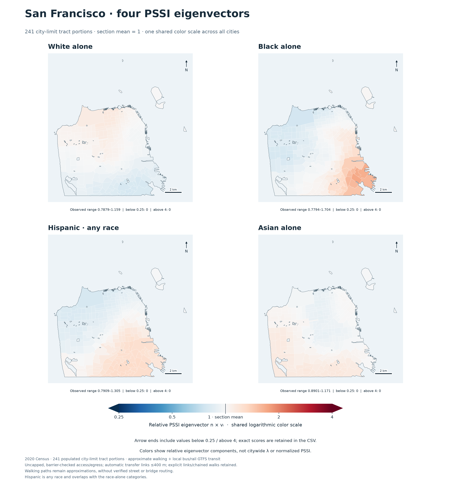

[White alone](docs/outputs/multicity/walk_access_revision/maps/san_francisco/white_alone_pssi_eigenvector.png) · [Black alone](docs/outputs/multicity/walk_access_revision/maps/san_francisco/black_alone_pssi_eigenvector.png) · [Hispanic · any race](docs/outputs/multicity/walk_access_revision/maps/san_francisco/hispanic_latino_any_race_pssi_eigenvector.png) · [Asian alone](docs/outputs/multicity/walk_access_revision/maps/san_francisco/asian_alone_pssi_eigenvector.png) · [Exact values](docs/outputs/multicity/walk_access_revision/maps/san_francisco/section_eigenvectors.csv)

## Washington, DC

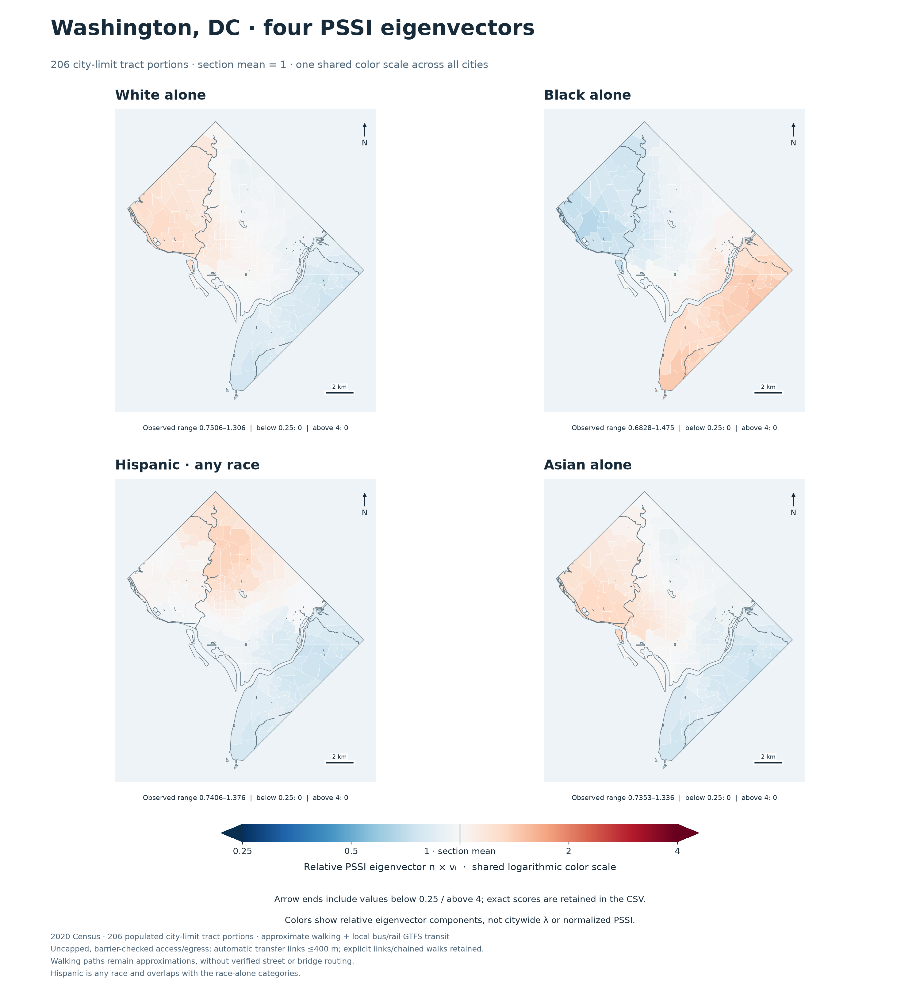

[White alone](docs/outputs/multicity/walk_access_revision/maps/washington_dc/white_alone_pssi_eigenvector.png) · [Black alone](docs/outputs/multicity/walk_access_revision/maps/washington_dc/black_alone_pssi_eigenvector.png) · [Hispanic · any race](docs/outputs/multicity/walk_access_revision/maps/washington_dc/hispanic_latino_any_race_pssi_eigenvector.png) · [Asian alone](docs/outputs/multicity/walk_access_revision/maps/washington_dc/asian_alone_pssi_eigenvector.png) · [Exact values](docs/outputs/multicity/walk_access_revision/maps/washington_dc/section_eigenvectors.csv)

## Houston

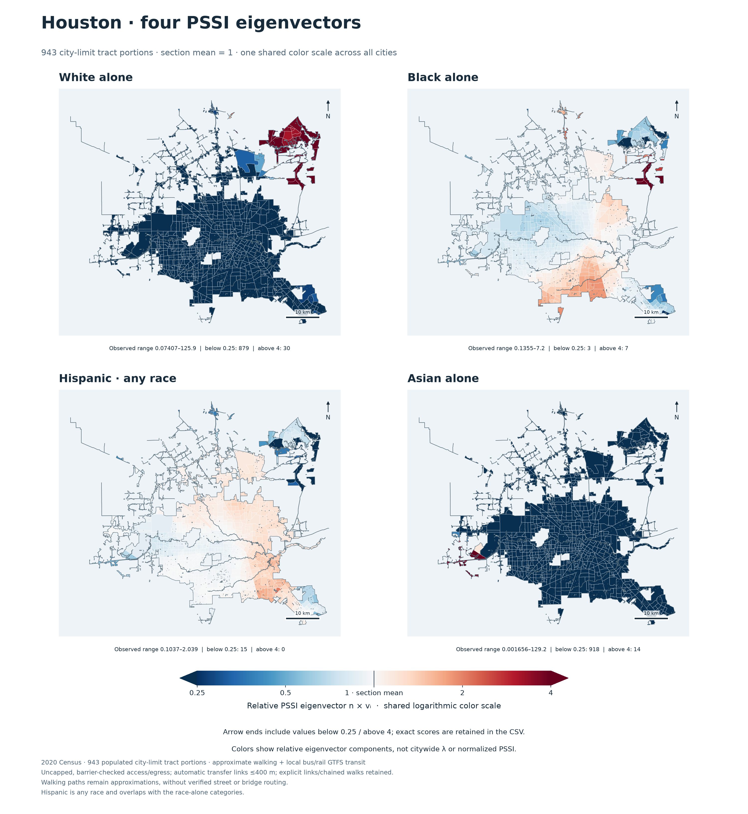

[White alone](docs/outputs/multicity/walk_access_revision/maps/houston/white_alone_pssi_eigenvector.png) · [Black alone](docs/outputs/multicity/walk_access_revision/maps/houston/black_alone_pssi_eigenvector.png) · [Hispanic · any race](docs/outputs/multicity/walk_access_revision/maps/houston/hispanic_latino_any_race_pssi_eigenvector.png) · [Asian alone](docs/outputs/multicity/walk_access_revision/maps/houston/asian_alone_pssi_eigenvector.png) · [Exact values](docs/outputs/multicity/walk_access_revision/maps/houston/section_eigenvectors.csv)

## Detroit

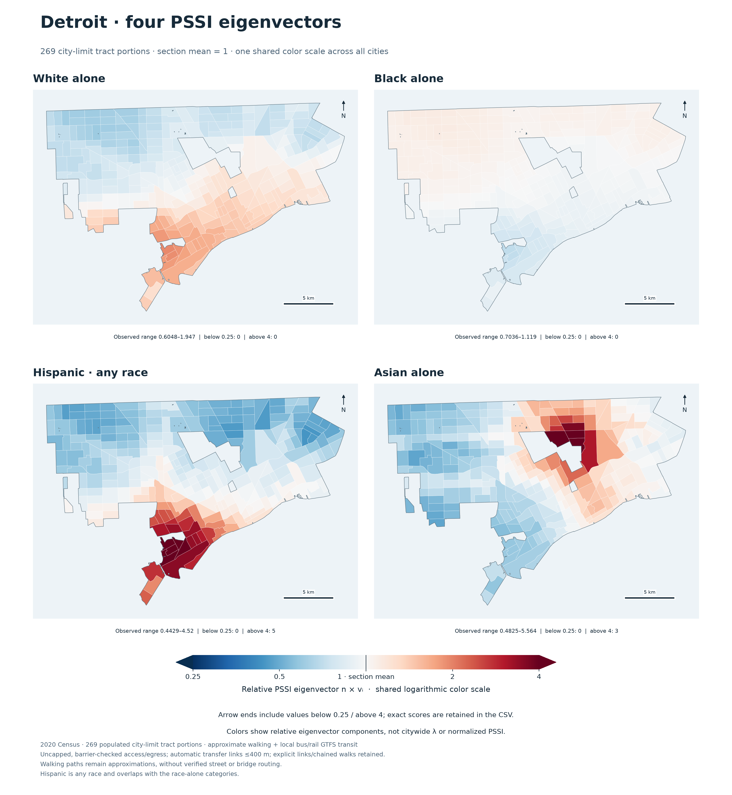

[White alone](docs/outputs/multicity/walk_access_revision/maps/detroit/white_alone_pssi_eigenvector.png) · [Black alone](docs/outputs/multicity/walk_access_revision/maps/detroit/black_alone_pssi_eigenvector.png) · [Hispanic · any race](docs/outputs/multicity/walk_access_revision/maps/detroit/hispanic_latino_any_race_pssi_eigenvector.png) · [Asian alone](docs/outputs/multicity/walk_access_revision/maps/detroit/asian_alone_pssi_eigenvector.png) · [Exact values](docs/outputs/multicity/walk_access_revision/maps/detroit/section_eigenvectors.csv)

## Chicago

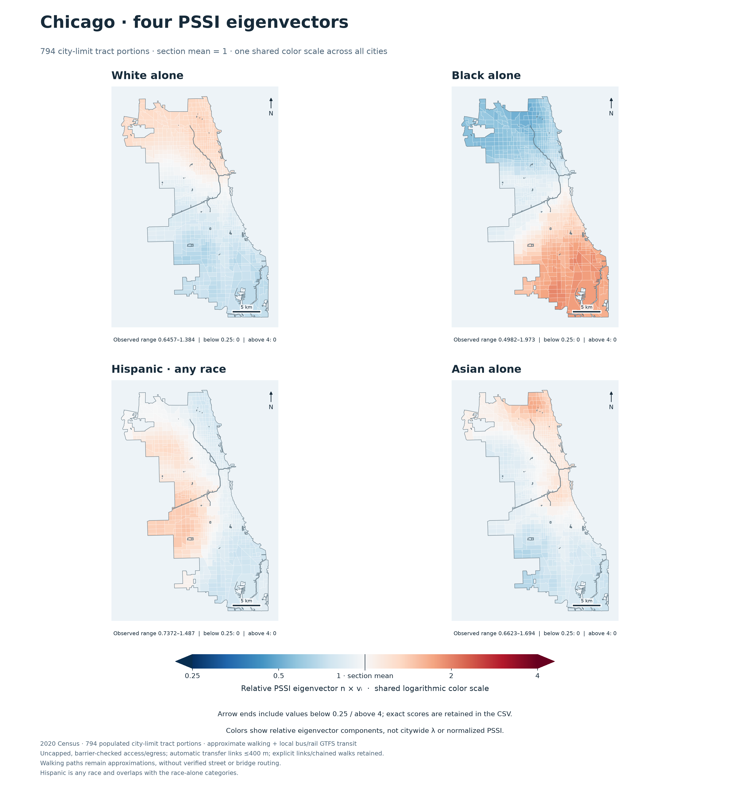

[White alone](docs/outputs/multicity/walk_access_revision/maps/chicago/white_alone_pssi_eigenvector.png) · [Black alone](docs/outputs/multicity/walk_access_revision/maps/chicago/black_alone_pssi_eigenvector.png) · [Hispanic · any race](docs/outputs/multicity/walk_access_revision/maps/chicago/hispanic_latino_any_race_pssi_eigenvector.png) · [Asian alone](docs/outputs/multicity/walk_access_revision/maps/chicago/asian_alone_pssi_eigenvector.png) · [Exact values](docs/outputs/multicity/walk_access_revision/maps/chicago/section_eigenvectors.csv)

## Phoenix

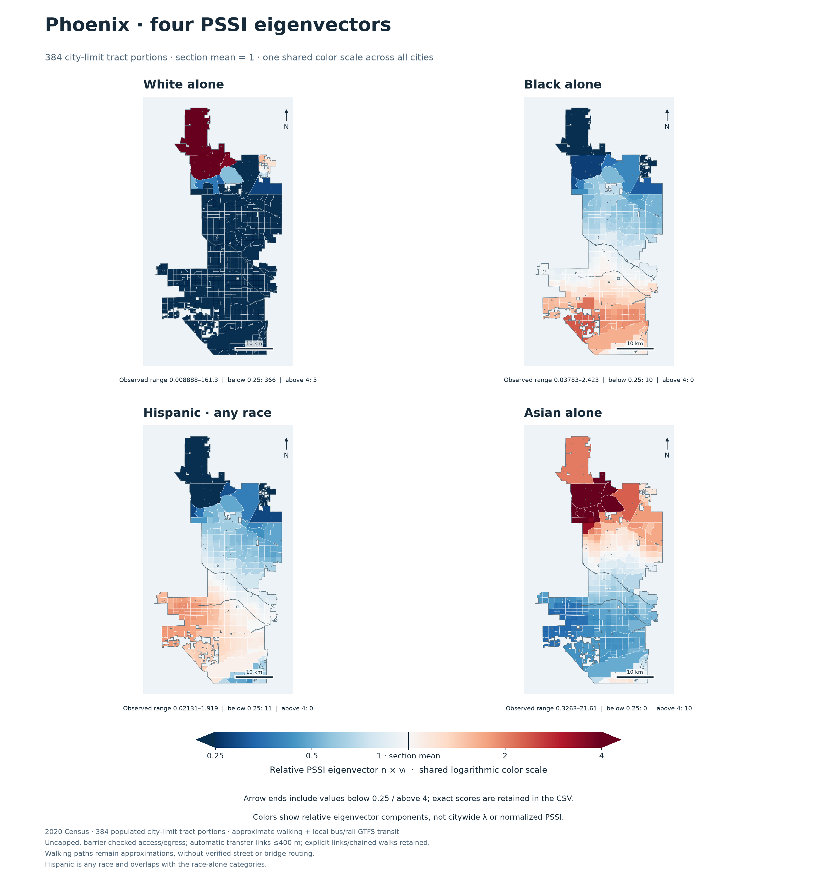

[White alone](docs/outputs/multicity/walk_access_revision/maps/phoenix/white_alone_pssi_eigenvector.png) · [Black alone](docs/outputs/multicity/walk_access_revision/maps/phoenix/black_alone_pssi_eigenvector.png) · [Hispanic · any race](docs/outputs/multicity/walk_access_revision/maps/phoenix/hispanic_latino_any_race_pssi_eigenvector.png) · [Asian alone](docs/outputs/multicity/walk_access_revision/maps/phoenix/asian_alone_pssi_eigenvector.png) · [Exact values](docs/outputs/multicity/walk_access_revision/maps/phoenix/section_eigenvectors.csv)

## Atlanta

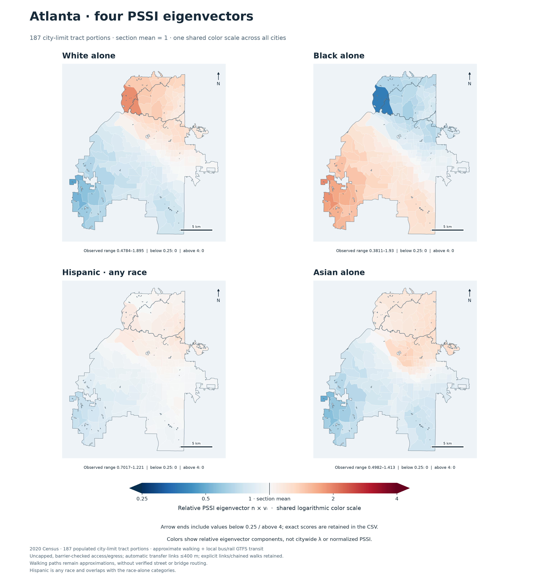

[White alone](docs/outputs/multicity/walk_access_revision/maps/atlanta/white_alone_pssi_eigenvector.png) · [Black alone](docs/outputs/multicity/walk_access_revision/maps/atlanta/black_alone_pssi_eigenvector.png) · [Hispanic · any race](docs/outputs/multicity/walk_access_revision/maps/atlanta/hispanic_latino_any_race_pssi_eigenvector.png) · [Asian alone](docs/outputs/multicity/walk_access_revision/maps/atlanta/asian_alone_pssi_eigenvector.png) · [Exact values](docs/outputs/multicity/walk_access_revision/maps/atlanta/section_eigenvectors.csv)
