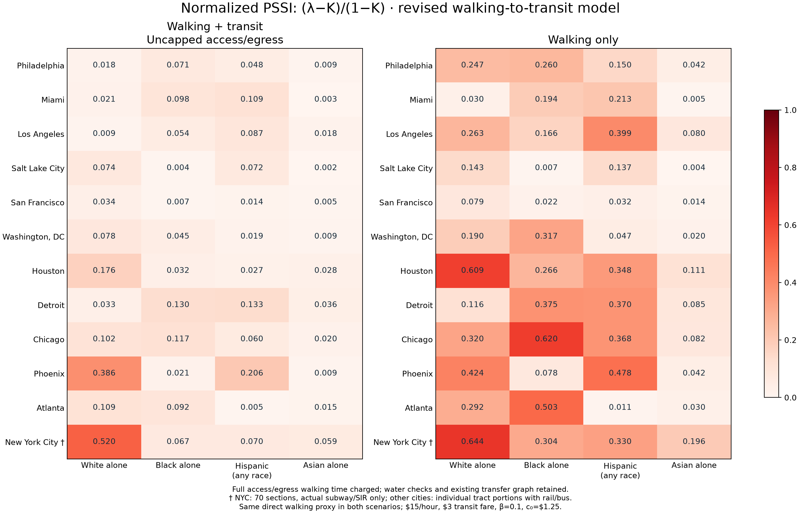

# Segregation, walking and public transit

Reproducible **2020 Census analysis of 12 US cities**, comparing walking-only and walking-plus-transit PSSI, geographic Fryer SSI, and four race-specific eigenvector maps per city.

**[Open the public results website](https://battlecode2020.github.io/APMA4903-segregation-transit/)** · **[Browse every city map on GitHub](PLOTS.md)** · **[Score table](docs/outputs/multicity/walk_access_revision/city_scores.csv)** · **[Column definitions](docs/outputs/multicity/walk_access_revision/city_column_dictionary.csv)**



## What is included

- **60 map images:** White alone, Black alone, Hispanic of any race, Asian alone, and a combined figure for every city.
- Raw PSSI, PSSI minus population share, normalized PSSI, and paired scenario differences.
- Separate **distance-based Fryer SSI**, SSI minus population share, and normalized SSI, at block and tract scales. Transit does not change this geographic graph.
- All published local scores, methods, source provenance, column dictionaries and numerical validation.
- Python source, tests, notebooks, slide sources and a self-contained snapshot for offline reproduction.

Cities: Philadelphia, Miami, Los Angeles, Salt Lake City, San Francisco, Washington DC, Houston, Detroit, Chicago, Phoenix, Atlanta and New York City.

## Reproduce the published results

Use **Python 3.11**. Clone the repository, create an environment, and install the pinned dependencies:

```bash
git clone https://github.com/Battlecode2020/APMA4903-segregation-transit.git
cd APMA4903-segregation-transit
python3.11 -m venv .venv
source .venv/bin/activate
python -m pip install -r requirements.txt
python -m unittest discover -s tests -q
python -m scripts.reproduce_public --maps --rebuild-neighbors
```

The reproduction command **disables network connections**. It checks the committed snapshot hashes, recomputes both PSSI scenarios and all geographic Fryer scores, rebuilds the 1 km neighbor graphs, regenerates all maps, and checks the scores/eigenvectors against the published tables. It writes to `outputs/multicity/walk_access_revision/`; the published snapshot in `docs/` stays unchanged.

For a faster score-only run, omit `--maps --rebuild-neighbors`. To check the downloaded files without calculating, use `python -m scripts.reproduce_public --verify-only`.

To browse the saved website locally:

```bash
python -m http.server 8000 --directory docs
```

Open `http://localhost:8000`. The [public review notebook](notebooks/Public_results.ipynb) reads the committed scores and figures without rerouting or downloading data.

## Model and parameters

For category `r`, the model uses `F_ij = exp(-beta * C_ij)`, `P_ij = F_ij D_j / sum_k(F_ik D_k)`, and `A_r = P diag(p_r)`. Raw PSSI is the largest eigenvalue of `A_r`. Its right eigenvector sums to one; the geographic maps display `n*v_i`, with node mean one.

| Setting | Value |
|---|---|
| Cost sensitivity beta | 0.1 per dollar |
| Value of time omega | $15/hour |
| Local cost floor c0 | $1.25, also used on the diagonal |
| Walking fare / transit fare | $0 / $3 per journey |
| Walking estimate | Great-circle distance × 1.3, at 4.8 km/hour |
| Access and egress | Uncapped distance; all walking time charged |
| Entrance / exit allowance | 60 seconds each |
| Transfer buffer | 60 seconds, increased where specified GTFS minimums apply |
| Automatic walking-transfer links | Within 400 m estimated walking distance; explicit GTFS links and chained walks retained |
| Transit service window | 07:00–10:00 agency local time |
| Saved service dates | October 20, 2026; San Francisco uses August 25, 2026 |
| Expected waiting | Half the estimated headway for each stop/service pattern |
| Ride and dwell times | Medians from the applicable saved GTFS trips |
| Fryer geographic threshold | 1 km, distinct nodes, no self-links |

For both metrics, `K` is the category's share of **all city residents**. Normalization is `(score - K)/(1 - K)`. The additional Fryer adjustment is `SSI - K`; this is the requested population-share adjustment, not the paper's simulated null-baseline correction.

## Interpretation and coverage

- Eleven cities use individual populated **city-limit tract portions**. NYC retains **70 custom sections**, a different spatial scale.
- NYC includes cached **subway/SIR only**, without buses, ferries or commuter rail. Its older hypothetical transit replacements are removed. Each other city's included and omitted agencies are documented in the [source inventory](docs/outputs/multicity/transit_sources.json).
- Census race-alone categories overlap Hispanic ethnicity. The four population counts do not form a partition.
- Walking is a geographic approximation. Conservative water/land checks can reject real bridge or street detours for transit access/transfers. Both scenarios retain identical complete direct-walking estimates, including flagged potential water crossings.
- Fryer uses the largest of the four category counts to label each node (tie order: Hispanic, Asian, Black, White), equal all-neighbor weights, and category restriction without row renormalization. Geographic isolates are excluded from its eligible-node denominator. Undefined scores remain missing.
- Map colors share a logarithmic range of **0.25–4** for `n*v_i`. Outside-range values are explicitly flagged; exact values remain in the CSVs.

These are model comparisons based on fixed illustrative parameters and saved schedules, not observed social contacts or validated door-to-door itineraries.

## Repository layout

| Path | Contents |
|---|---|
| `docs/` | Public website, all published tables, maps and source notices |
| `reproducibility/` | Saved travel estimates, exact prepared display geometries, snapshot checksums |
| `scripts/reproduce_public.py` | Offline public reproduction entry point |
| `scripts/` | Original Census, transit, scoring, plotting and validation code |
| `tests/` | Automated tests, including synthetic routing checks |
| `notebooks/Public_results.ipynb` | Portable review of the committed results |
| `PROJECT_HISTORY.md` | Original project documentation and earlier workflows |

The snapshot reproduces analysis from the saved travel estimates and Census inputs. Large raw GTFS/Census downloads and redundant dense matrices are excluded. The original acquisition/routing scripts and feed checksums are included for audit; rerouting from raw sources requires the corresponding original downloads, and current agency URLs may return different schedules. The reproduction command regenerates the dense cost, interaction and race matrices locally.

No Routes API calls are needed for the public workflow. Historical optional Routes API modules are not invoked.

## Sources and attribution

Population and boundaries: US Census 2020 P.L. 94-171 and TIGER/Line. Transit: the agency-produced static GTFS feeds listed in the [source inventory](docs/outputs/multicity/transit_sources.json), including identified public archive copies where required. Fryer references and interpretation choices are recorded in [citations.json](docs/data/references/fryer/citations.json).

See [DATA_SOURCES.md](DATA_SOURCES.md) and the retained [agency attribution notices](docs/outputs/multicity/data_attribution.txt). Original analysis validation is available in the [published report](https://battlecode2020.github.io/APMA4903-segregation-transit/outputs/multicity/walk_access_revision/index.html); each fresh reproduction produces its own `public_reproduction_verification.json`.
